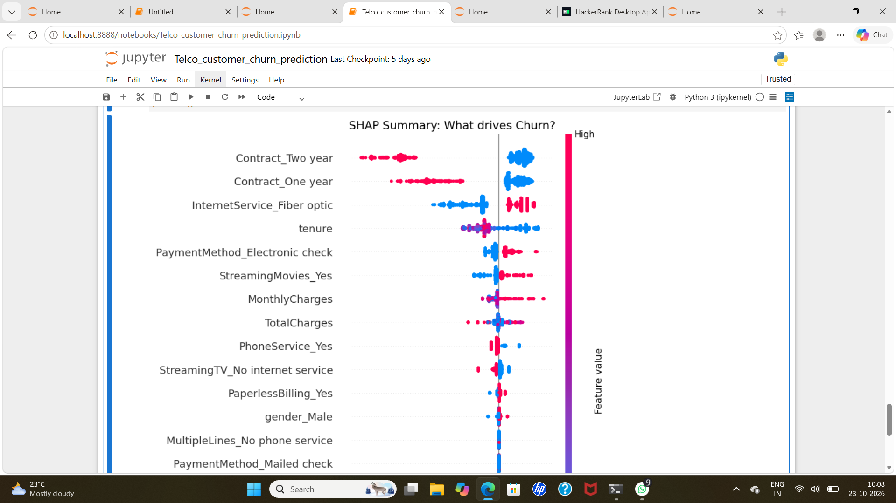

# Telco Customer Churn - Decision Tree Classifier

## Problem Statement
A telecom company is losing 26.5% of its customers. The goal of this project is to predict which customers will churn so the business can intervene with retention offers before they leave.

## Dataset
- *Source:* IBM Telco Customer Churn (Kaggle)
- *Size:* 7,043 rows, 21 features
- *Target:* Churn (1 = Yes, 0 = No)

## Approach
1. *Data Cleaning:* Converted TotalCharges to numeric and filled 11 blanks with 0 (representing new, unbilled customers). Dropped customerID.
2. *Feature Engineering:* Created TotalServices by summing the count of active services per customer (proxy for engagement/switching cost).
3. *Encoding:* Used One-Hot Encoding (get_dummies) for all categorical features.
4. *Modeling:* Split data with an 80/20 stratified split to maintain the 26.5% churn ratio. Trained a DecisionTreeClassifier with max_depth=5 and min_samples_leaf=50 to prevent overfitting, using class_weight='balanced' to handle the minority class.
5. *Evaluation:* Optimized for *Recall* (missing a churner costs a customer; a false positive just costs a retention call).

## Results
- *Decision Tree Recall:* 80.4%
- *Dummy Baseline Recall:* 0.0% (proves accuracy is misleading on imbalanced data)
- *Random Forest Recall:* 48.6%
- *Logistic Regression Recall:* 78.8%

## Key Insight
The model achieved an 80.4% recall, meaning it successfully identifies 8 out of 10 at-risk customers. The Decision Tree outperformed both Logistic Regression and Random Forest on recall while providing fully interpretable decision paths. The most important features were Contract_Two year, Contract_One year, and InternetService_Fiber optic, proving that contract lock-in and service type are the strongest retention levers.

## Technologies Used
Python, Pandas, Scikit-learn, Matplotlib, Seaborn

2. Install requirements: pip install -r requirements.txt
3. Open the Jupyter Notebook: jupyter notebook churn_analysis.ipynb
4. ## Explainable AI (XAI) - SHAP

The SHAP summary plot reveals that Contract_Two year strongly reduces churn risk, while InternetService_Fiber optic increases it

## Decision Tree Visualization

![Decision Tree](decision_tree.png

